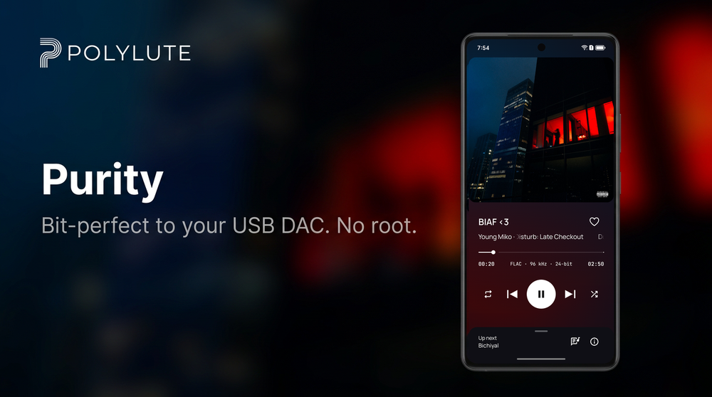
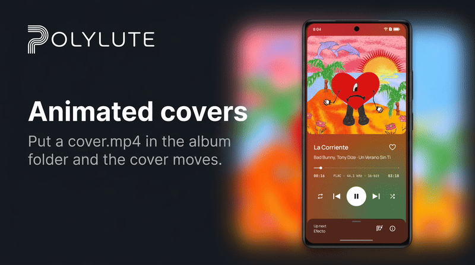
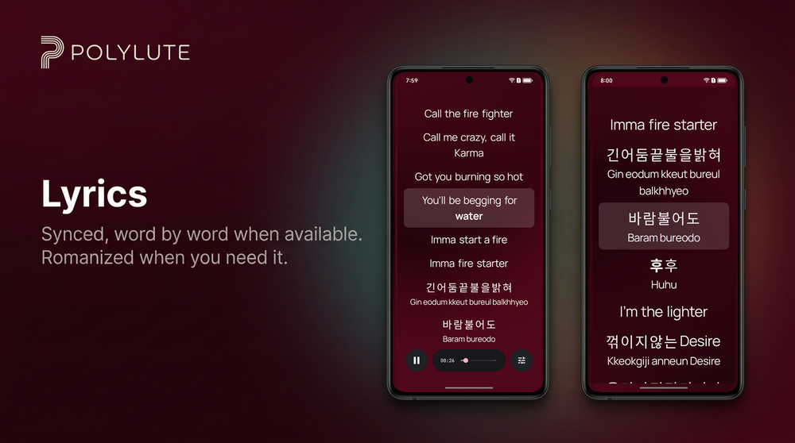
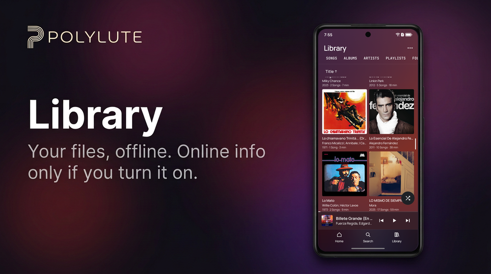
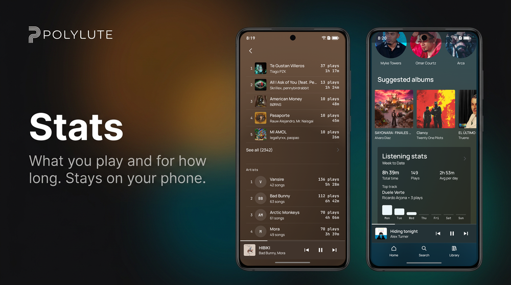
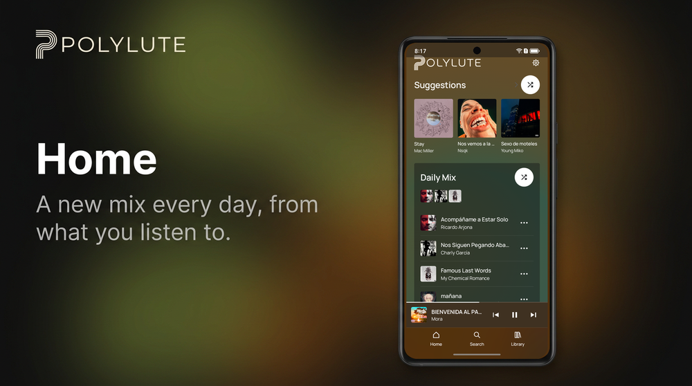

<p align="center">
  <picture>
    <source media="(prefers-color-scheme: dark)" srcset="docs/readme/polylute-wordmark-dark.svg">
    
  </picture>
</p>

<p align="center">
  <a href="https://github.com/NeonShapeshifter/Polylute/releases/latest"></a>
  
  <a href="PixelPlayerOSS/LICENSE"></a>
</p>

Polylute is an Android music player for the files on your device.

It can send audio straight to a USB DAC, bit-perfect (Purity), or through its own processing (Resonance: per-headphone profiles, an equalizer and volume limits). It can also turn a phone into a dedicated digital audio player (DAP mode).

<p align="center">
  
  
</p>
<p align="center">
  
  
</p>
<p align="center">
  
  
</p>

## Install

You do not need to build anything: download the APK from [Releases](https://github.com/NeonShapeshifter/Polylute/releases/latest).
Each release has one APK per ABI, named `Polylute-<version>-<abi>.apk`: take `arm64-v8a` for most phones, `armeabi-v7a` for older 32-bit phones.
If the release includes a `SHA256SUMS` file, check the download against it, for example `sha256sum -c SHA256SUMS --ignore-missing` in the download folder.

## Requirements

- Android 10 (API 29) or newer.
- A USB DAC for Purity and for Resonance over USB.
- To build: JDK 21, Android SDK 37, Android NDK 29.0.14206865 and CMake 3.21 or newer. Set the SDK path in `PixelPlayerOSS/local.properties` (`sdk.dir=...`) or with `ANDROID_HOME`.

## Two ways to use it

**App mode** is a normal music player. Install it and use it. Nothing is locked.

**DAP mode** is for a phone used only as a player. Open Settings, Home and DAP mode. Choose the home app; once Polylute is the home app, choose a level:

- **Home** (called Launcher in the app): Polylute is your home screen. Nothing is locked.
- **Pinned**: Android's app pinning keeps Polylute on screen until you unpin it. No adb needed.
- **Dedicated**: Android's Lock Task with Polylute's own lock screen. It needs Device Owner, set up once with adb.

App mode, Home and Pinned need nothing but the APK. Only Dedicated needs a computer, once, because Android lets an app become the device owner only through adb (or a factory reset with an enterprise setup).

### Is Dedicated for you?

Dedicated is for turning a phone, ideally a spare one, into a DAP: a phone that does one thing. On a phone you use every day, use App mode, or Pinned if you want it locked on screen. They need no computer and nothing to remove.

### Setting up Dedicated

1. Install Polylute and turn on USB debugging.
2. Remove every account from the phone, and every extra user.

   Why: Android only names a device owner on a phone that looks unused, with no accounts and no other users. It is a security rule. It matters only at the moment of the command in step 3; add the accounts back right after, and no factory reset is needed.

   Samsung's Secure Folder and work profiles count as extra users, and deleting them deletes the data inside. If you need that data, back it up first, or stay with App mode or Pinned.
3. From a computer, run the command for your build:

   ```sh
   # release build (app.polylute)
   adb shell dpm set-device-owner app.polylute/com.lostf1sh.pixelplayeross.dap.admin.DapDeviceAdminReceiver

   # debug build (app.polylute.debug, a separate app)
   adb shell dpm set-device-owner app.polylute.debug/com.lostf1sh.pixelplayeross.dap.admin.DapDeviceAdminReceiver
   ```

   The Dedicated page in the app shows the command for the build you are running and can copy it. Android may refuse; nothing is active until Android confirms it.
4. Add the accounts back.
5. Make Polylute the home app: Settings, Home and DAP mode, Choose home app. On a Device Owner phone the level is Dedicated; there is nothing else to choose.

### Leaving Dedicated

Settings, Home and DAP mode, **Stop being the device owner** (in the Spanish app: "Dejar de ser propietario del dispositivo"). Polylute clears what it set and gives up Device Owner. No reset is needed. Polylute stays the home app until you pick another one with Choose home app. If you cannot open the app at all, a factory reset also ends it.

## Animated covers

Put a `cover.mp4`, `cover.webp` or `cover.gif` in an album's folder and the full player plays it, muted and in a loop, in place of the still cover. Turn it on in Settings, Appearance, **Animated covers**; on Android 13 and newer, Polylute asks once for the folder your music is in (read only).

- If a folder has more than one, mp4 wins, then webp, then gif. mp4 is the lightest by far: it is decoded in hardware.
- The 64 MB limit is for gif and webp only (they are decoded in memory, so a bigger one is not played). An mp4 has no size limit: the hardware decoder reads it a few seconds at a time. You rarely need a big one: a 720 px, 15 to 30 second H.264 or HEVC mp4 is a few MB and looks sharp on a phone.
- The cover belongs to the album: a song of the album that sits in another folder plays it too.
- A folder that mixes albums (such as `Music` or `Download`) is never used for one album's cover.
- A disc of its own: in an album folder whose songs are on two or more discs, `disc1.jpg` (or `.jpeg`, `.png`) is the cover of the songs on disc 1, `disc2.jpg` of disc 2, and so on. It beats `cover.*` and the song's own picture for those songs; the album itself keeps its own cover (`cover.*`, else the picture in the files), never a `discN` file. A folder with one disc is not searched for them. `disc2.mp4` (or `.webp`, `.gif`) is the animated cover of disc 2, with the same rules as `cover.mp4`; a disc with none plays the album's `cover.mp4`. Not `cd1.jpg`: that name is often a picture of the CD itself.
- It plays only on the full player's cover page, and stops when the screen is off or the player is closed. Lists, the mini player and the lock screen keep the still cover.

## Build

```sh
cd PixelPlayerOSS
./gradlew :app:assembleDebug
```

Run Gradle with JDK 21. The APKs are in `app/build/outputs/apk/debug/`, one per ABI; add `-Ppixelplayer.enableAbiSplits=false` for a single universal APK. The debug build is the app `app.polylute.debug`, separate from the release app `app.polylute`.

For a release build, see [PixelPlayerOSS/docs/release-signing.md](PixelPlayerOSS/docs/release-signing.md).

For the reasoning behind selected build and implementation choices, see the [engineering notes](PixelPlayerOSS/docs/engineering-notes.md).

The repository has two parts: `PixelPlayerOSS/` is the app, and `decent-player/` holds the USB audio driver, the Media3 wrapper and the FLAC decoder.

## Privacy and notices

What the app stores and every network request it can make: [PixelPlayerOSS/PRIVACY.md](PixelPlayerOSS/PRIVACY.md).

Third-party notices: Settings, About, Licences and open-source notices in the app, or [PixelPlayerOSS/app/src/main/assets/licenses/THIRD_PARTY_NOTICES.md](PixelPlayerOSS/app/src/main/assets/licenses/THIRD_PARTY_NOTICES.md).

## License and credits

Polylute is based on PixelPlayerOSS (GPL-3.0) and decent-player (MIT).

- PixelPlayerOSS, Copyright (C) 2026 Theo Vilardo, maintained by [lostf1sh](https://github.com/lostf1sh): https://github.com/lostf1sh/PixelPlayerOSS
- decent-player, Copyright (c) 2026 Marcelo Silva: https://github.com/Ma145/decent-player

The licenses are in `LICENSE` (GPL-3.0, the same text as `PixelPlayerOSS/LICENSE`), `decent-player/LICENSE` and `decent-player/NOTICE.md`.
`decent-player/` stays under the MIT licence, with its own `LICENSE`.

© 2026 Polylute contributors · GPL-3.0-or-later.  
A fan nod to Risk of Rain 2; not affiliated with Gearbox or Hopoo Games.

All Freedoms Granted Until Gearbox Says Otherwise.

Please don't send Mithrix.
